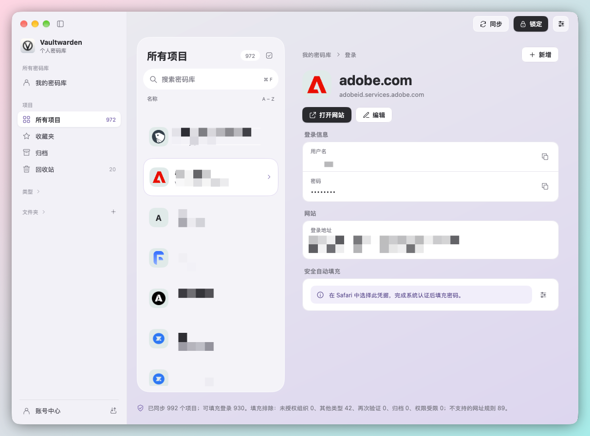
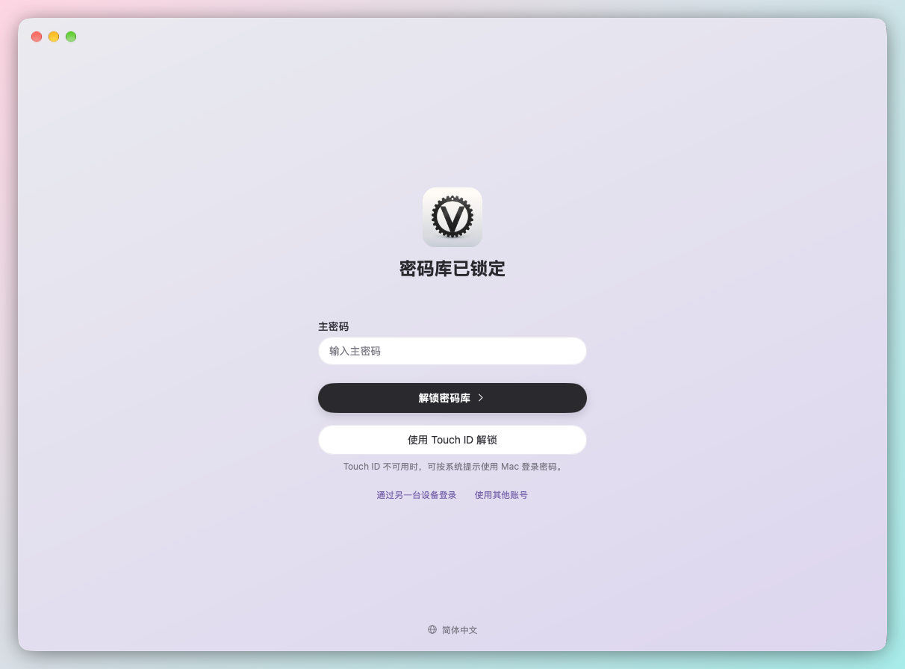
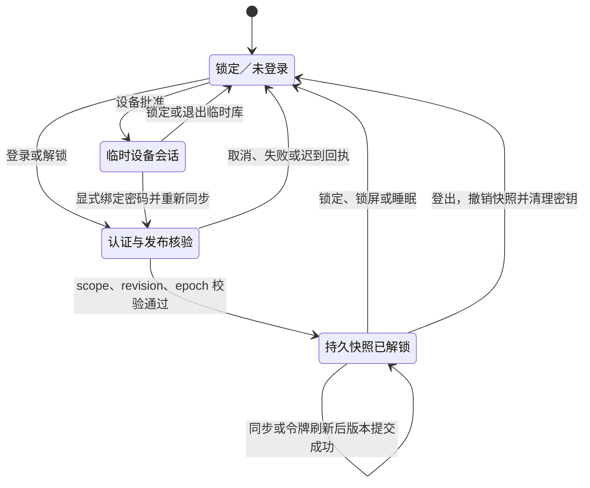

# MyGo Vaultwarden

**[English](README.md) | 简体中文**

一款为 macOS 打造的原生 Vaultwarden 密码管理客户端。连接你自托管的 Vaultwarden 服务器，在 Mac 上浏览、搜索和编辑密码库，用 Touch ID 解锁，并在 Safari 中通过系统自动填充输入密码。

<table>
  <tr>
    <td width="50%"></td>
    <td width="50%"></td>
  </tr>
  <tr>
    <td align="center">密码库主窗口</td>
    <td align="center">主密码与 Touch ID 解锁</td>
  </tr>
</table>

截图中的个人数据已打码。

## 主要功能

- 原生界面：Go + MyGo Native UI 与 Swift/AppKit，主窗口不使用 WebView，遵循 macOS 的窗口、菜单与快捷键习惯。
- 个人密码库：登录、支付卡、身份、安全笔记、SSH 密钥等八种项目，支持收藏、文件夹、归档、回收站与批量管理，`⌘F` 即时搜索，并显示网站图标。
- 安全解锁：主密码或 Touch ID 解锁本机加密快照；锁屏、睡眠或空闲 15 分钟后自动锁定。
- 系统自动填充：在 macOS“自动填充与密码”中启用后，可在 Safari 选择凭据并经系统认证后填充。
- 导入导出：使用 Bitwarden 兼容 JSON，可在官方客户端与本应用之间迁移数据。
- 账号中心：Send、设备登录与审批、两步验证、账号安全和紧急访问。
- 自动更新，界面支持简体中文与英文。

## 安全

- **运行在 macOS 应用沙盒中**：主应用与自动填充扩展均启用 App Sandbox。文件访问仅限于你明确选择的文件和目录，导出时不会覆盖已有文件。
- **静态加密**：完整密码库只以受 Keychain 与主密码保护的 AES-GCM 本机快照形式保存。
- **最小权限自动填充**：系统扩展在独立的沙盒进程中运行，只读取按权限和策略过滤的 Login 投影；必须由你选择凭据并通过系统认证后才会填充。
- **强密钥派生与自动锁定**：弱 KDF 参数会在发起任何在线请求前被拒绝；锁屏、睡眠或空闲 15 分钟后自动锁定。
- **更新验签**：安装更新前会校验 Ed25519 签名与归档 SHA-256 摘要。
- **设计上更安全**：主窗口不使用 WebView；写入结果未知时不会自动重放。

## 本版范围

使用 Go + MyGo Native UI 和 Swift/AppKit 构建的 macOS Vaultwarden 客户端，采用 GPL-3.0-only。主窗口不使用 HTML、JavaScript 或 WebView。

本版聚焦个人密码库。支持八种个人项目的保存、搜索、编辑、复制、同步，以及文件夹、收藏、归档和回收站。自定义字段、密码历史、URI 匹配和逐字段冲突核对沿用完整加密模型。

导入导出只使用 Bitwarden 兼容 JSON，不定义自己的文件格式；无法用该格式完整表示的内容会被明确阻止。带附件项目的副本支持有界流式处理、逐文件恢复、同步续接和下载核验。敏感读取和再次验证有短期授权，未知写入结果不会自动重放。

应用分为几个原生窗口：主窗口负责登录解锁、密码库浏览与编辑；“设置”窗口（`⌘,`）包含通用（语言）、账号、存储与自动填充、更新和关于；“账号中心”窗口（侧栏入口或“账号”菜单，`⇧⌘A`）提供 Send、设备登录与审批、账号安全、MFA 和紧急访问。账号中心一次只连接一个页面；锁定、主窗口正在编辑或有操作进行时不打开面板，并说明原因。关闭主窗口只隐藏它，点击 Dock 图标恢复，`⌘Q` 退出。登录按服务器要求完成 MFA。

设备批准后的临时在线库不持久保存运行期密钥或 token，也不注册运行期 AutoFill。显式绑定密码后必须重新同步，才能发布持久快照。替换另一账号的本机缓存需要明确确认和系统认证；旧保护未解决时拒绝替换，未知结果只检查同一次操作。

**组织产品 UI 延期到下一版本。** 本版不开放组织、成员、群组、集合管理及管理员恢复等业务入口，也不提供占位按钮。底层模块与开发成果保留，完整范围见验收矩阵。

同步仍完整保存组织加密数据和未知字段，并继续执行组织政策、权限、隔离与 pending 约束；个人列表不会把组织条目当作个人条目。完整用户密钥轮换仍核验必要的组织恢复材料，缺少证据时停止。已有跨账号恢复屏障可以由目标本人重新认证和核验，但这不开放管理员操作。

完整同步保存在受 Keychain / 主密码保护的 AES-GCM 本机快照中。系统 AutoFill 使用独立、按权限和策略过滤的 Login 投影；它不代表本版开放组织业务 UI。

令牌刷新先加密落盘。UI/worker 代次、账号范围、快照标识和存储版本共同阻止迟到结果重新打开密码库。普通同步不能清除未解决的账号变更或跨账号恢复日志。

当前交付范围、执行证据与平台限制以 [本版验收矩阵](docs/personal-release-acceptance.md) 为准；[API 模块矩阵](docs/vaultwarden-api-coverage.md) 保留底层能力记录，不等同于本版 UI 承诺。冲突处理见 [docs/cipher-conflicts.md](docs/cipher-conflicts.md)，安全存储见 [docs/secure-snapshots.md](docs/secure-snapshots.md)。

## 状态与术语

| 术语 | 实际含义 |
|---|---|
| scope（账号范围） | 规范化服务器地址与稳定账号 ID 的组合，防止把一个账号的数据用于另一个账号。 |
| epoch（代次） | 进程内 UI 或工作任务的授权代次；锁定、取消或切换后，旧任务回执不能继续改变当前界面。它不是时间戳。 |
| snapshot（快照） | 本机 AES-GCM 加密数据，包含完整服务器加密同步文档、最小填充投影和必要的加密会话材料。 |
| snapshot ID（快照标识） | 每次发布生成的随机标识，绑定系统 AutoFill 候选；旧候选不能命中新快照。 |
| revision（存储版本） | 跨进程控制状态的版本；锁定、更新或撤销会推进版本，提交时必须匹配预期值。 |
| lease（临时授权） | 对指定 scope/版本/用途的短期授权，使用前仍需核验，不等于持久登录。 |
| recovery（恢复日志／屏障） | 记录账号变更或跨账号恢复的未决操作和核验证据；防止未知结果被重复写入或普通同步覆盖。与备份文件恢复是不同流程。 |
| pending（待确认） | 已开始但尚未完成核验的变更；收到 HTTP 200 或重启应用不能自行解除它。 |
| CAS（比较后提交） | 提交时检查预期 revision，拒绝覆盖锁定、切换或其他进程刚更新的状态。 |

以下图描述主应用的主要授权状态；扩展在独立进程中认证读取持久快照。恢复屏障是与锁定状态同时存在的限制，解锁不会自动清除它。



## 开发环境

- macOS 14+、完整 Xcode、Go 1.27.1+。
- MyGo 固定 v0.4.2（Native UI 使用值类型 Element），保留 goja 与官方 zxcvbn 的主密码评分实现。
- `go` 不在 PATH 时使用 `GO_BIN=/absolute/path/to/go`；`scripts/resolve-go.sh` 也识别项目用户缓存工具链。
- 真实 AutoFill 安装需要 Apple Developer Program、Xcode 登录账号、相应证书及 provisioning profile。未签名构建不能证明系统填充可用。

## 目录结构

| 目录 | 内容 |
|---|---|
| `main.go` | 薄入口，调用 `internal/app` |
| `internal/app` | 应用控制器：主窗口、设置与账号中心窗口、菜单、生命周期、登录解锁、同步、自动更新与密码库编辑器 |
| `internal/ui` | UI：`kit` 共享组件，`account`、`send`、`organization` 领域面板 |
| `internal/vaultwarden` | Vaultwarden 协议客户端，`vaultcrypto`、`totp`、`vaulterr` 子包 |
| `internal/localstore`、`internal/fileio`、`internal/platform` | 本机加密快照、本地文件暂存、原生桥与系统认证 |
| `third_party` | 官方 zxcvbn 与第三方许可证 |
| `tools`、`scripts` | Go 开发工具；构建、安装与许可证脚本 |
| `macos` | Xcode 工程、AutoFill 扩展与 Swift 安全存储桥 |

依赖方向、测试放置约定和新代码的归属见 [docs/architecture.md](docs/architecture.md)。

## 构建与安装

完整开发入口：

```sh
bash scripts/dev-debug.sh
# 仅构建、安装、启动一次
bash scripts/dev-debug.sh --once
```

该脚本监听 Go、Swift、资源及构建配置，完整构建主应用、安全存储桥与 AutoFill 扩展，验证签名后安装并重启。首次启动前退出已安装应用；构建失败保留正在运行的版本。原有 `mygo dev` 预览不会被关闭。代码重载不保留内存登录状态，已有加密快照可重新认证解锁。

也可分别执行：

```sh
bash scripts/build-macos.sh debug
bash scripts/install-macos.sh debug
```

产物为 `build/debug/MyGo Vaultwarden.app`，安装到 `~/Applications/MyGo Vaultwarden.app`。脚本不会替用户开启系统 AutoFill。仅预览界面可运行 `go tool mygo dev`；该 `.dev` 模式不含安全存储及 AutoFill，不能用于验收这些功能。

签名设置写在忽略的 `.local/signing.env`，变量为 `MYGO_SIGNING_IDENTITY`、`MYGO_TEAM_ID` 和可选的 `MYGO_NOTARY_PROFILE`。证书私钥、公证凭据及 provisioning profile 不应提交。主应用与扩展的 bundle ID 必须匹配自己的团队配置。

```sh
bash scripts/build-macos.sh release
# 可选：本地打包、公证，不上传发行站点
bash scripts/build-macos.sh release --notarize
```

Xcode 管理主应用和扩展两个 target；Go build phase 生成主可执行文件，原生扩展嵌入 `Contents/PlugIns`，共享 Swift 桥位于 `Contents/Frameworks/libSnapshotBridge.dylib`。应用图标与资源说明见 [docs/app-icon.md](docs/app-icon.md)。

## 自动更新

配置更新源与公钥的 Release 构建支持 MyGo 原生自动更新，可在“设置 › 更新”或应用菜单“检查更新…”控制。Debug 和未配置的构建不会自动更新。发布新版本：改好版本号与 `CHANGELOG.md` 并提交后，在本机运行 `bash scripts/release.sh`，它用本机证书与更新私钥完成测试、签名、公证、生成更新文件，并上传草稿 release；密钥配置、发布步骤与验收见 [自动更新与发布](docs/updates.md)。

## 使用与安全边界

1. 输入服务器、邮箱和主密码，按服务器实际要求完成 MFA。使用 HTTPS，仅本机回环允许 HTTP。
2. 个人项目按类型、文件夹、收藏、归档或回收站筛选。使用 `⌘F` 搜索，键盘上下键选择；详情可复制用户名或打开 HTTP(S) 网站。列表与详情会向当前 Vaultwarden 服务器的 `/icons/{域名}/icon.png` 请求网站图标，只发送公开网址的域名，不携带登录令牌、网址路径或查询参数；不跟随图标接口重定向。内网 IP、本地域名、再次验证条目及读取失败时保留首字母。成功图标自动以 PNG 缓存到系统用户缓存目录下的 `MyGo Vaultwarden/WebsiteIcons`（macOS 为 `~/Library/Caches/MyGo Vaultwarden/WebsiteIcons`，沙盒路径由系统决定），按服务器、账号和域名哈希命名，保存 7 天、最多 1024 张；这些可删除的图片缓存未加密，不写入密码条目或同步快照。
3. 锁定立即隐藏列表、详情和敏感输入，并撤销内存权限。重启后可用主密码或系统认证解锁持久快照。已解锁状态默认在系统用户空闲 15 分钟后锁定；后台同步不续期，其他应用的键鼠活动计入系统活动，UI 阻塞可能延迟执行。
4. 在 macOS“自动填充与密码”启用 MyGo Vaultwarden，再实际核验 Safari 填充。严格 Host / Exact 规则只在系统给出可核对来源时匹配。
5. 账号变更、紧急接管或未知切换若留下恢复记录，使用对应专用入口核验；取消、重启、普通登录或 HTTP 200 本身都不能代替完整证明。

附件内部 spool 创建后立即 unlink，仅保留描述符；这不承诺磁盘安全擦除或阻止同用户调试读取。文件导入导出通过用户选择面板取得当次访问能力，最终发布仍检查授权并拒绝覆盖；签名沙盒实机授权尚待验证。在线 PBKDF2 低于 100,000 次会拒绝认证，Argon2id 支持 16–1024 MiB；旧快照离线兼容范围不同。可变缓冲区清理与权限撤销不能证明 Go/Swift、交换区或崩溃转储中的所有秘密副本归零，详见[内存清理边界](docs/secure-snapshots.md#内存清理的保证范围)。

原始主密码不发送到服务器，不写配置、日志或命令行。持久 payload 保存加密的 refresh token、设备标识和必要密钥材料，不保存原始密码或 access token；临时设备会话不写入这些材料。普通网络失败保留上次成功缓存；身份、密钥、授权或来源失效会停止当前权限。退出临时库只撤销临时能力，保留无关磁盘账号。

密钥轮换的固定 Vaultwarden 1.37.4 兼容判断是对所配置服务器的协议声明，不是二进制远程证明。公开接口无法独立读回的恢复包装采用已记录的严格协议顺序见证，并与实际读回证据区分。不可判定时保留屏障和恢复材料。

## 测试

```sh
go test -tags headless ./...
go vet -tags headless ./...
swift test --package-path macos
swift test --package-path macos/Authentication
```

Go/Swift 测试覆盖加密、身份/权限、生命周期、持久化、URI 匹配和原生组件。常规 CI 在 Linux/macOS 跑 Go，在 macOS 加跑 race 与两个 Swift 包；可选 live 夜间任务的资源许可、跳过语义与日志见 [CI 与验证边界](docs/ci.md)。

真实服务/CLI 回环只使用独立、带所有权标记的本机固定版本实例。模拟 Keychain、headless UI 和隔离 C ABI 不能证明真实 Touch ID、签名沙盒、Safari 或 IdP 系统窗口已经验证。具体结果和大库测量见验收矩阵。

```sh
codesign --verify --deep --strict 'build/debug/MyGo Vaultwarden.app'
pluginkit -m -v -i yz.sh.mygo-vaultwarden.autofill
```

## 许可证与来源

项目采用 [GPL-3.0-only](LICENSE)。自动填充流程参考 KeePassium，来源及复用范围见 [THIRD_PARTY_NOTICES.md](THIRD_PARTY_NOTICES.md)。MyGo、goja、zxcvbn 等保留各自许可证，应用包携带第三方声明。
