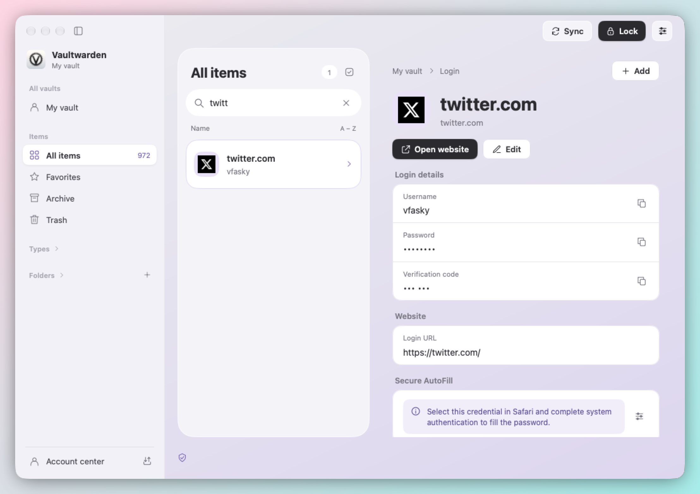
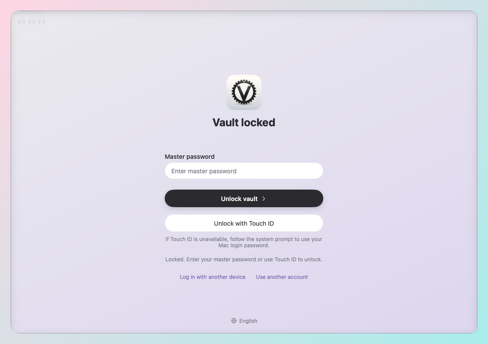

# MyGo Vaultwarden

**English | [简体中文](README-cn.md)**

A native macOS client for [Vaultwarden](https://github.com/dani-garcia/vaultwarden). Connect to your self-hosted server, browse, search and edit your vault on your Mac, unlock with Touch ID, and fill passwords in Safari through the system AutoFill.

<table>
  <tr>
    <td width="50%"></td>
    <td width="50%"></td>
  </tr>
  <tr>
    <td align="center">Main vault window</td>
    <td align="center">Master password and Touch ID unlock</td>
  </tr>
</table>

Personal data in the screenshots has been redacted.

## Features

- **Native UI**: built with Go + MyGo Native UI and Swift/AppKit. The main window uses no WebView and follows macOS conventions for windows, menus and shortcuts.
- **Personal vault**: eight item types (logins, payment cards, identities, secure notes, SSH keys and more), with favorites, folders, archive, trash and bulk management. Instant search with `⌘F` and website icons.
- **Secure unlock**: unlock the encrypted local snapshot with your master password or Touch ID. The vault locks automatically on screen lock, sleep, or after 15 minutes of inactivity.
- **System AutoFill**: enable it under macOS "AutoFill & Passwords", then pick a credential in Safari and fill it after system authentication.
- **Import and export**: uses Bitwarden-compatible JSON, so you can move data between the official clients and this app.
- **Account center**: Send, login with another device and approval, two-step verification, account security and emergency access.
- **Automatic updates**, with a UI available in Simplified Chinese and English.

## Security

- **Runs in the macOS App Sandbox**: both the main app and the AutoFill extension are sandboxed. File access is limited to the files and folders you explicitly choose, and exports are published without overwriting existing files.
- **Encrypted at rest**: the full vault is stored only as a local AES-GCM snapshot protected by the Keychain and your master password.
- **Least-privilege AutoFill**: the system extension runs in its own sandboxed process and reads a separate Login projection filtered by permissions and policy. A credential is filled only after you select it and complete system authentication.
- **Strong key derivation and locking**: weak KDF settings are rejected before any online request. The vault locks on screen lock, sleep, or after 15 minutes of inactivity.
- **Verified updates**: updates are checked against an Ed25519 signature and the archive SHA-256 digest before they are installed.
- **Safe by design**: no WebView in the main window, and unknown write results are never replayed automatically.

## Scope of this release

This release focuses on the personal vault: saving, searching, editing, copying and syncing the eight personal item types, plus folders, favorites, archive and trash. Organization management (members, groups, collections, admin recovery) is deferred to a later version.

The full synced vault is kept in a local AES-GCM snapshot protected by the Keychain and your master password. System AutoFill uses a separate, permission-filtered Login projection.

For delivery scope, evidence and platform limits, see the [release acceptance matrix](docs/personal-release-acceptance.md). Related documents: [API coverage](docs/vaultwarden-api-coverage.md), [cipher conflicts](docs/cipher-conflicts.md) and [secure snapshots](docs/secure-snapshots.md). Detailed design notes are in [README-cn.md](README-cn.md) (Chinese).

## License

GPL-3.0-only. See [LICENSE](LICENSE) and [THIRD_PARTY_NOTICES.md](THIRD_PARTY_NOTICES.md).
